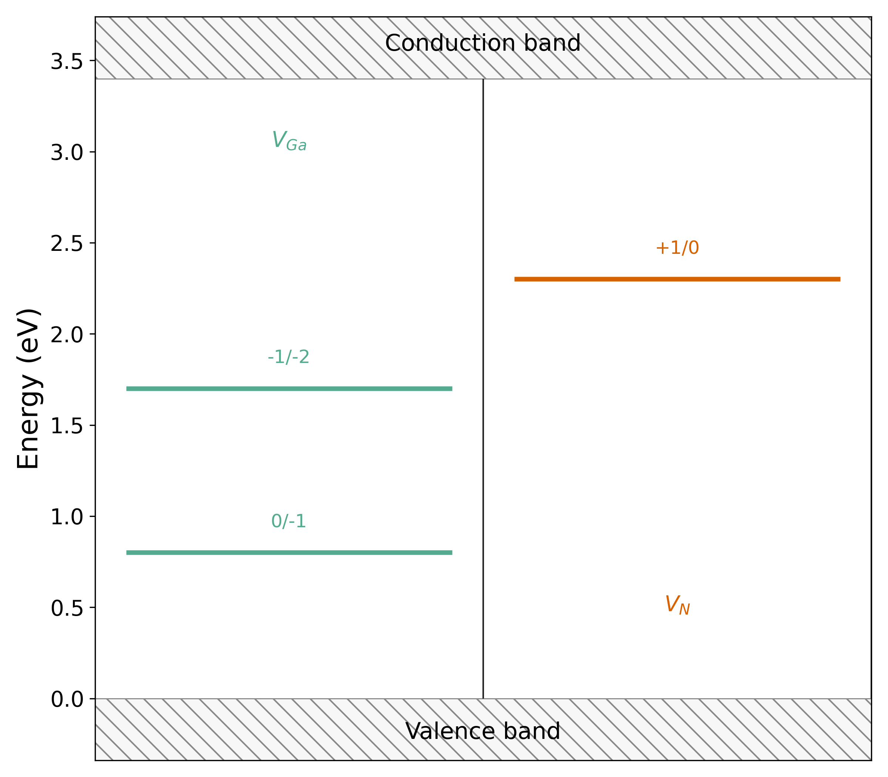

# iLED Local

iLED 1.11.14 的本地集成版本，提供标准 pip 安装、提交脚本修复及原生绘图示例。

**适用环境：Linux x86-64、Python 3.10。** 原生计算模块来自原始 iLED wheel，原包许可标注为 Proprietary；本项目是本地集成快照。许可信息见 [LICENSE](LICENSE) 和 [第三方说明](THIRD_PARTY_NOTICES.md)。

## 安装

推荐在单独的 conda 环境中安装：

```bash
conda create -n iled python=3.10 -y
conda activate iled
git clone https://github.com/swanwu1996/iled-local.git
cd iled-local
python -m pip install .
iled-local-info
```

也可以直接通过 Git 安装：

```bash
python -m pip install "git+https://github.com/swanwu1996/iled-local.git"
```

pip 会从本仓库 Release 下载约 200 MiB 的原始 iLED wheel，核对 SHA-256，安装其 Python 依赖和本地集成层。安装后的集成版本为 `1.11.14.post1`，上游版本为 `1.11.14`。Python 3.11 及以上、Windows、macOS 和 ARM 不适用于此二进制版本。

## 运行

在自己的计算目录中准备 `POSCAR` 和 `iLED.para` 后：

```bash
conda activate iled
cd /path/to/calculation
iLED -pre
```

VASP、MPI、Slurm 和赝势库需按计算环境配置。`potcar_path` 应填写绝对路径。`cluster=slurm` 会尝试提交计算；`cluster=local` 可用于 PRE 输入生成。不同模块对该选项的行为需按其流程核对。

## 当前集成内容

| 内容 | 实现 |
| --- | --- |
| 本地启动器 | `src/iled_local/cli.py`，保留本地 activation override 行为 |
| 提交脚本修复 | `src/CDLE/AutoRun/__init__.py`，清除脚本开头多余的反斜线及换行，使第一行为 `#!` |
| 环境信息 | `iled-local-info`，显示集成版本、上游版本和 Python 环境 |
| 绘图示例 | `examples/plot-demo/demo.py`，调用原生电荷态跃迁能级绘图函数 |

脚本修复覆盖原生 AutoRun 的 8 个 `write_*jobfile*` 方法，保持脚本正文、文件权限和原生 `.so` 文件不变。集成包和上游包共同提供 `iLED` 命令，因此请在专用环境中使用；需要移除时，建议直接删除该环境。

## 原生画图示例

克隆仓库并安装后：

```bash
python examples/plot-demo/demo.py
```

结果位于 `examples/plot-demo/cdle/transition_level.{png,pdf,svg}`。以下示例的全部数值为虚构演示数据，不代表 GaN 或其他材料的计算结果。



实际计算结束后，`CDLE_plot` 可读取计算目录中的 `tsle.json`、`cdle.json`，绘制缺陷形成能和跃迁能级。

## 验证与文件记录

- 本机真实 `iLED -pre` 已生成 VASP 输入文件。
- 8 个原生脚本生成方法的头部修复通过测试。
- 原目录提交脚本通过 `sbatch --test-only`，检查没有提交计算。
- 原生绘图函数已生成 PNG、PDF、SVG。

这些记录覆盖软件运行与输入生成，尚未验证全部科学计算工作流。历史分析和检查记录位于 `docs/`；其中路径及部分相对链接指向原调查目录。

`snapshot.json` 保存原始 wheel 和捕获补丁的校验值，`working-pip-freeze-no-iled.txt` 保存原工作环境的 Python 依赖记录。旧环境的手动补丁安装/回退工具保留在 `tools/`，标准 pip 安装无需执行它。

## 问题反馈

仓库和 Release 不包含许可证文件、POTCAR、私钥、访问令牌或用户计算结果。请勿在 Issue 中粘贴这些内容。报告问题时请附 `iled-local-info` 输出、所用模块、脱敏参数及报错信息。
