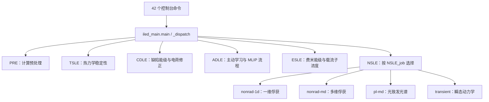

# iLED 1.11.14 静态分析

**iLED 是面向材料缺陷的计算工作流平台。** 它组织 VASP 结构与能量计算、缺陷电荷修正、机器学习替代计算、非辐射俘获和载流子动力学，并管理输入、集群作业及结果。这个判断来自发布包的接口、脚本、编译模块符号和内嵌文档；具体数值实现与计算精度尚未运行验证。

对象是 `dist/iled-1.11.14-cp310-cp310-linux_x86_64.whl`。原始 SHA-256：`f618f1d5286bb2f290e98a64face9cce902a1d5fd4bcb63675c1822e6aecc580`。没有修改安装包，也没有导入 iLED、启动 VASP 或提交集群作业。

**制品结构与入口**

| 项目 | 观察结果 | 来源 |
|---|---|---|
| 包身份 | iLED 1.11.14；电子能级缺陷计算集成工作流 | [METADATA](interface-files/iled-1.11.14.dist-info/METADATA) |
| 平台 | 这个 wheel 绑定 CPython 3.10 / Linux x86-64 | [WHEEL](interface-files/iled-1.11.14.dist-info/WHEEL) |
| 文件 | 259 个非目录成员，解压约 316 MB，其中 210 个 `.so` | [成员清单](wheel-members.json) |
| 命令 | 42 个 console scripts，全部指向 `iled_main:main` | [入口声明](interface-files/iled-1.11.14.dist-info/entry_points.txt) |
| 编译方式 | 扫描的 209 个功能模块都是 Cython 扩展，保留 `.symtab`，没有 `.debug_info` | [编译模块元数据](compiled-module-metadata.json)；范围不含 `runtime_guard` |
| 主入口 | ELF 共享对象；30 个节、767 条符号表记录、422 条重定位；导出 `PyInit_iled_main` | [REA 入口布局](rea-main-layout.json)；符号记录包含不同表的重复项，并非 767 个函数 |
| 完整性 | 检查 wheel RECORD 中 258 个有哈希的成员，均匹配；RECORD 本身没有自哈希 | [验证记录](verification.json) |

入口保留 `main` 和 `_dispatch`。其内嵌文档明确描述按 `argv[0]` 查分发表，导入对应模块并调用 `mod.main()`，同时隔离 `sys.path`；还能观察到 `DISPATCH`、`FLAG_MAP`、`importlib`、`basename` 和 `argv` 常量。`main` 主体局部符号地址为 `0x10f00`，`_dispatch` 主体为 `0xc5c0`。这是静态实现线索，尚未建立每个分支的完整指令级可达性证明。来源：[入口证据](iled-main-dispatch-evidence.json)、[限定范围反汇编](iled-main-dispatch-disassembly.txt)、[REA ELF 布局](rea-main-layout.json)。

内嵌帮助显示的入口样式为 `iLED -pre / -tsle / -cdle / -adle / -nsle / -esle`。这些选项是包中实际存在的文本，未通过运行 CLI 验证。

图表示接口分组与包中描述的分派关系，不表示所有计算必须按这些模块的排列顺序执行。

**各模块承担什么工作**

| 模块 | 包中可见功能 | 关键证据 |
|---|---|---|
| PRE | 预处理，以及 static、aexx、final 等入口 | 主入口帮助；入口声明 |
| TSLE | 竞争相、凸包稳定性、两步弛豫、精化静态能量及再分析 | CM-S019–024 |
| CDLE | 本征/掺杂缺陷准备，中性与带电态 relax/static，电荷修正和结果绘图 | CM-S013–018；入口声明 |
| ICCP / cor_byy | FNV、FNV2D、SLABCC、PA、LZ 等带电缺陷修正接口 | [公开导出](interface-files/cor_byy/iccp/__init__.py) |
| ADLE / CDLE_mlip | 缺陷数据集、DFT、模型训练/部署、结构松弛和最终 DFT 补算 | CM-S025–030；[CDLE_mlip 声明](interface-files/CDLE_mlip/__init__.py) |
| ESLE | 从缺陷形成能重建稳定电荷态，求电中性费米能级、电子/空穴及缺陷浓度 | CM-S031–035 |
| NSLE 1D | PES 准备/拟合、Wif、线形、Sommerfeld 修正、俘获系数 | CM-S039–042；[模块声明](interface-files/nsle1d/__init__.py) |
| NSLE 多维 | 声子、模式投影、电子声子耦合、EMA / Duschinsky 路径和多模式俘获 | CM-S043–045；[模块声明](interface-files/nslemd/__init__.py) |
| NSLE PL | Γ 点声子和谱计算；宿主/缺陷嵌入大超胞分支 | 三个可读 PL shell 脚本 |
| NSLE transient | 无光生项平衡预运行、随后积分指定 G(t) 和电荷态动力学 | CM-S046–049 |
| MLCD | relax → static → CHGCAR 收集 → EAC 训练；预测电荷密度、PAW 拼接与 NSCF | CM-S050–053 |

CM 编号是本次生成的本地静态证据编号，不是 REA Evidence ID；每条绑定 wheel 成员、文件偏移或符号地址。完整文本与来源见 [53 条精选证据](compiled-curated-evidence.json) 和 [编译模块报告](compiled-module-findings.md)。表中的方法名称证明接口/文档存在，没有证明公式实现正确或当前集群运行成功。

**几条值得关注的计算链**

- **ADLE 五阶段**：准备并提交 VASP → 检查 VASP/组织训练数据 → 检查和部署模型、评估及松弛 → 分析 MLIP 推断并选择 final_dft 补算 → 汇总 DFT/MLIP 结果。阶段说明直接来自 `ADLE/calcu.so` 内嵌文档（CM-S025–029）。
- **ESLE 温度处理**：文档描述先求生长温度平衡，再固定各缺陷总浓度、在工作温度重新分配电荷态；费米能级使用电中性二分求解器。该物理假设是后续检查参数和结果时的重要边界（CM-S031–035）。
- **NSLE 多维**：内嵌文档保留完整模式间矩阵的非对角项，并提供初态/末态基的 Duschinsky 路径。不能把它概括为单纯的一维模型或对角模式求和（CM-S043–045）。
- **PL 非嵌入流程**：初末态结构 → phonopy 位移 → Slurm 数组运行 VASP → 收集 `vasprun.xml` → `FORCE_CONSTANTS` 和 Γ 点本征矢 → PL CLI。嵌入流程再加入 host、defect、supercell 阶段。[详细脚本分析](package-interface.md)

**运行条件与能力边界**

METADATA 写 `Requires-Python >=3.10`，但它不能覆盖 wheel 的 `cp310` 二进制 ABI 限制：当前这个文件应使用匹配的 CPython 3.10 环境。没有验证其它 ABI 的发行包是否存在。

依赖分为三层：Python 包（ASE、pymatgen、phonopy、NumPy/SciPy 等），外部计算程序（VASP、MPI、部分电荷修正工具和 MLIP/EAC 程序），调度环境（可见 Slurm，部分模板也带 PBS）。仅安装 wheel 不等于这些外部条件已配置。`DT_NEEDED` 中只有 libc/libpthread 也不代表完整运行依赖仅有这两项。

ADLE 明确保留 “MACE/SevenNet support is currently a placeholder” 文本，要求配置实际框架的训练/部署命令和模型路径（CM-S030）。因此这些 ADLE 接口需要进一步集成验证；这条结论不能推广为 NSLE 多维模块完全不支持 SevenNet。

功能模块带有构建机器的绝对 RPATH；是否影响本机加载没有测试。内嵌 Allegro 示例、CUDA/LAMMPS 路径和队列模板也具有集群相关性。

**优先核查的实现问题**

| 问题 | 直接观察及影响 | 建议核查 |
|---|---|---|
| PL 作业完成判定偏弱 | SCF 数组脚本只要看到 `OUTCAR` 就跳过；后续按 `vasprun.xml` 存在计数。这可能复用失败或截断结果 | 同时检查作业退出状态、输出完整性和电子收敛 |
| 非嵌入分支的等待计数 | `set -e` 下 `wait_for_all_vasprun` 用裸 `((expected++))` / `((count++))`，初值 0 时命令返回 1；函数在缺输出分支被独立调用 | 检查等待分支，使用不会因初值 0 返回失败的计数形式 |
| PL 的 fallback 文件缺失 | `NSLE_PL_cli` 不在 PATH 时 fallback 指向同目录 `pl_cli.py`，该 wheel 只含对应 `.so` | 确认 console script 已安装，或调整 fallback 的实际启动方式 |
| 旧力常数直接复用 | 部分路径看到 `FORCE_CONSTANTS` 即复用，没有在这些可读脚本中核对结构/参数指纹 | 检查是否需要失效缓存和记录输入指纹 |

来源：[非嵌入脚本](interface-files/nsle_pl_runtime/pl_without_embedding.sh)、[嵌入脚本](interface-files/nsle_pl_runtime/pl_embedding.sh)、[具体行号与可达性条件](package-interface.md)。

对计数问题，独立 Bash 语义探针确认：裸后增量在 `set -e` 下返回退出码 1，前增量正常；函数放在 `if` 条件中的行为不同。因此这条问题只针对报告中明确指出的独立调用分支。没有执行目标 PL 脚本，不能声称某次计算已经因此失败。[探针结果](verification.json)

**REA 使用范围与证据**

| REA 结果 | Evidence / 身份 | 实际覆盖 |
|---|---|---|
| 原始 wheel 打开与识别 | [rea-original-target.json](rea-original-target.json)，SHA-256 为本报告开头的原包哈希 | 原始 ZIP 身份；全量递归 inventory 未完成 |
| 精选子包 inventory | `ev_f11280f515051877bd0756fa568c4b85a76499846bf195f004d5a07ec662d622`；[完整结果](rea-subset-inventory.json) | 从原包按原始字节构造的 33 成员子包；不是全包递归覆盖 |
| 子包内层库存 | `ev_9664ccf85281b74de842b56742880929d2dc3005b5189ad8f3904c72b803a270` | 图清单 `agm_ea772978ccc29d49cbb88827db8eb8250e62baef67a7bf0faf675145095dc9d0` |
| 主入口 ELF 布局 | `ev_fa9dedfeeeb3ae3f72a75e2b3f983275e3b7f9162e1d2cd27a2b84c661597d8c`；[完整结果](rea-main-layout.json) | 原始 `iled_main.so` 的节、符号、重定位与链接信息 |

REA 的原包递归库存任务耗时较长后被取消。普通 ZIP 读取确认 `TSLE/TSLE/POSCAR.zip` 有 326,860 个非目录成员，这提示递归展开的规模很大；没有把这一点当作工具内部耗时原因的已验证诊断。之后构造小型调查子包，成员逐一保留原始字节与哈希，来源关系见 [subset-provenance.json](subset-provenance.json)。

ELF 布局使用 REA 公共 CLI 和项目内独立 Python 分析环境（pwntools 4.15.0、pyelftools 0.33、Unicorn 2.1.2）；因为当前 MCP 进程没有配置该 Python 路径，通过 CLI 设置本次调用环境完成分析。没有修改 Codex 的持久配置。REA ELF 布局不是深度反编译，本次没有 Ghidra/Hopper/IDA 的伪代码结果。

脚本阅读、RECORD 校验、批量符号/字符串索引和 Bash 语义探针是普通本地工具结果，已与 REA Evidence 分开记录。REA 的布局结果不宣称目标执行、动态库实际解析位置或完整重定位覆盖。

**问题清单的完成程度**

| 问题 | 状态 |
|---|---|
| 软件身份、包结构与 ABI | 已回答 |
| 命令入口和分发方式 | 静态接口与分派意图已回答；逐分支指令级可达性未验证 |
| 功能模块与主要工作流 | 静态架构已回答 |
| 外部依赖和运行约束 | 声明与脚本依赖已回答；本机部署可用性未测试 |
| PL 等可见脚本风险 | 已定位，计数语义有独立验证；目标运行未测试 |
| 科学公式、精度和所有参数默认值 | 未验证；需要选定具体模块继续追踪或使用参考计算对照 |

进一步分析最有价值的候选是 `ESLE.calcu` 的温度/电中性求解，`nslemd.capture` 的多模式俘获矩阵，或 PL 的等待和续算分支。当前证据索引可以供这些定向调查复用。
